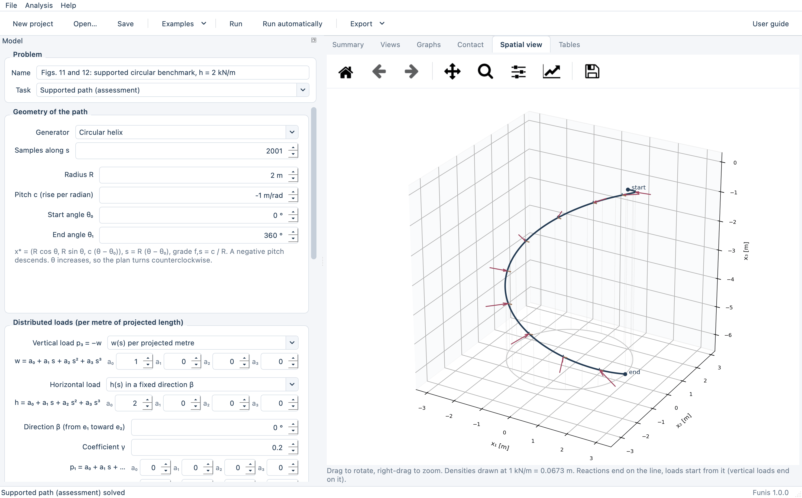
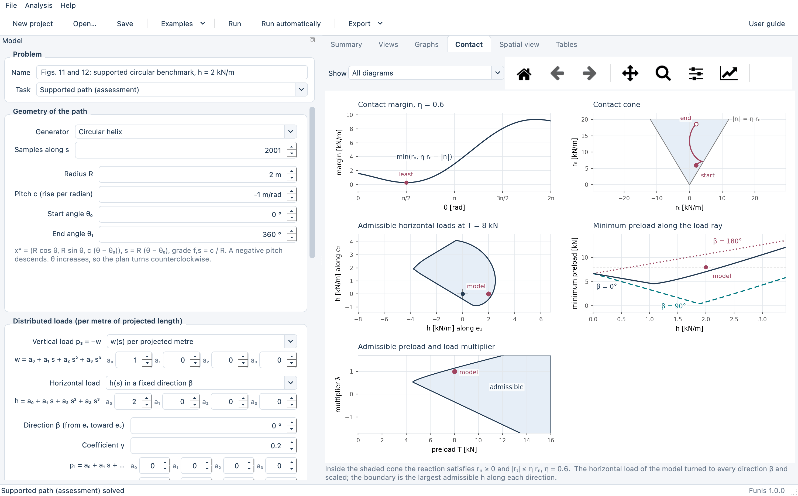
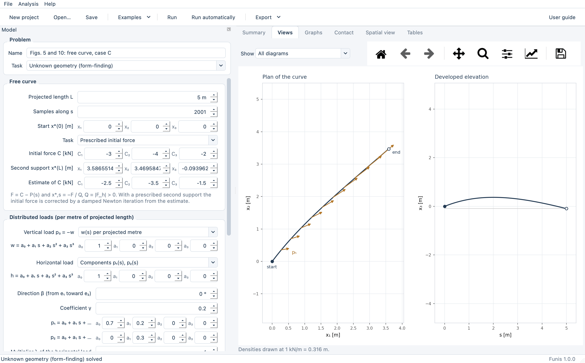
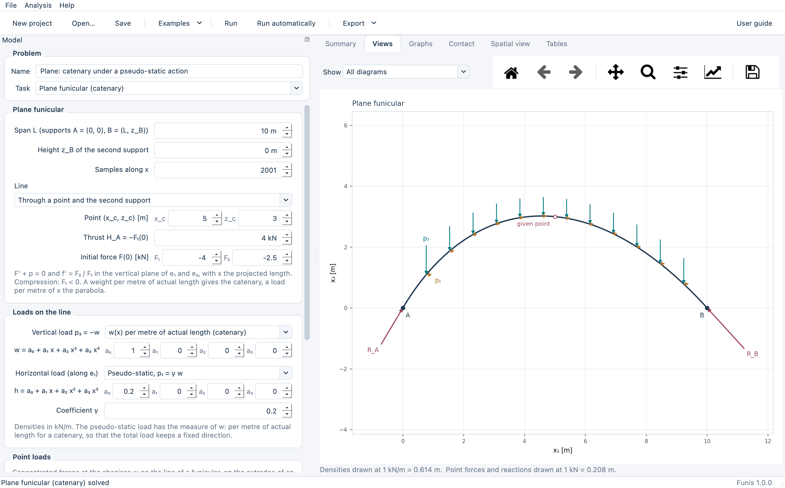
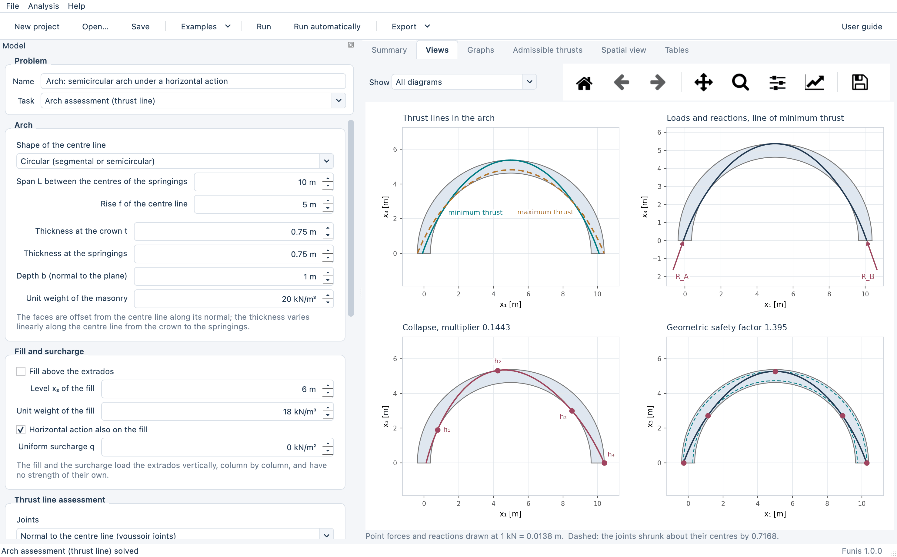

# Funis

[](https://doi.org/10.5281/zenodo.24040974)
[](https://github.com/colivieri89/Funis/actions/workflows/tests.yml)
[](https://github.com/colivieri89/Funis/releases/latest)
[](LICENSE)


Equilibrium and form-finding of spatial compression paths: the analytical Linear Arch Static Analysis (LASA) of continuous spatial compression paths under vertical and horizontal loads. The equations follow C. Olivieri, *Equilibrium and form-finding of spatial compression paths under multidirectional loading through Linear Arch Static Analysis*.

Funis is a desktop application for Windows and macOS. It needs no other software: the installers contain everything, Python included. **[Download the installers from the latest release.](https://github.com/colivieri89/Funis/releases/latest)**



*Supported path: the circular benchmark of the article (Figs. 11 and 12), a descending helix under vertical and horizontal loads with its lateral reactions, in the rotatable spatial view.*

## What it does

| Task | Input | Output |
|---|---|---|
| Supported path (assessment) | circular helix, elliptical helix (f = cθ or f = k_s s) or smooth path through points; vertical load per projected or actual length; horizontal load in a fixed direction, pseudo-static or by components; point actions; preload T = −S(0); side of the wall; contact cone (μ, L_sw, δ) | thrust S, axial force N, reactions r_t and r_n with their shift −p_h, end forces, point reactions and jumps, contact margin, admissible preloads and multipliers, admissible region of (T, λ), admissible horizontal loads at the given preload, minimum preload along three load directions, exact bound of Appendix A for the descending circle |
| Path without reactions | geometry and loads (check), or the conserved component B of loads in a fixed vertical plane, or a prescribed thrust S(s) | best initial force and transverse residual with verdict, or the compatible loads h and p₃, or the required three-component loads |
| Unknown geometry (form-finding) | loads as functions of s (per projected or actual length), point actions, start point, initial force C or prescribed second support with an estimate of C | curve, S = −Q, N = −&#124;F&#124;, curvature and torsion, distance from the plane of C and p(0), endpoint correction history, eigenvalues of K, closed form of Appendix B for constant loads |
| Node under a concentrated force | F⁻, G and an optional point reaction R | F⁺, tangents T⁻ and T⁺, change of tangent, force polygon |
| Plane funicular (catenary) | span L and height z_B of the second support; vertical load w(x) per metre of actual length (catenary), per metre of x (parabola) or by table; optional horizontal load h(x) per metre of x or pseudo-static γ w; point loads; the line through a point and the second support, with a prescribed thrust H, or from the initial force | line z(x), forces F₁ and F₃, N = −&#124;F&#124;, reactions at A and B, the closed form where one exists (parabola, catenary, logarithmic branch of Appendix B, catenary with an inclined axis) and its distance from the integrated line |
| Arch assessment (thrust line) | centre line circular, pointed, elliptical, parabolic, catenary or through points; thickness at the crown and at the springings, depth, unit weight; joints normal to the centre line or vertical sections; fill and surcharge above the extrados; point loads on the extrados; horizontal action λ of the weights; friction at the joints | lines of minimum and maximum thrust and the line through three points (e/t), geometric safety factor, collapse multiplier of the horizontal action or of the point loads with its hinges and the check by the mechanism, minimum thickness with the loads recomputed, friction needed at the joints, eccentricities along the arch, admissible thrusts against the multiplier |

The spatial tasks draw the plan with the load and reaction densities and the developed elevation to scale, the graphs along the path (forces, reactions, loads, residuals, curvature and torsion), the contact diagrams, and a rotatable spatial view. The plane tasks draw the line or the arch to scale with its loads, the graphs of the forces and of the eccentricity e/t, and for an arch the collapse mechanism, the reduced arch of the geometric safety factor, the arch of minimum thickness and the admissible thrusts. Every result carries independent checks: the global force and moment balance of all actions on the line and a finite-difference test of the local equations. Labels are placed at draw time clear of the geometry and of each other (`funis/labels.py`), on screen and in every exported file. Exports: PDF, SVG and PNG (fitted to a width, or views to scale with a scale bar), DXF (layers per view, 3D polyline of the path), CSV, Excel, JSON, a self-contained HTML report and the project file (`.funis`, JSON). The Examples menu holds the cases of the article (figure and section numbers refer to it), three reference cases, and the plane cases: funiculars checked against their closed forms and arches, among them the semicircular arch of minimum thickness under its own weight.

Units: m and kN, load densities in kN per metre of projected length, angles in degrees. Tension positive, compression S ≤ 0. In the plane tasks x is horizontal and z vertical, the thrust is H = −F₁ > 0, unit weights are in kN/m³ and an arch carries its loads over the depth b normal to its plane.

## Screenshots

<table>
  <tr>
    <td width="50%"><a href="docs/screenshots/contact.png"></a></td>
    <td width="50%"><a href="docs/screenshots/form_finding.png"></a></td>
  </tr>
  <tr>
    <td><sub>Supported path: contact margin and cone, admissible horizontal loads, minimum preload and admissible region of preload and load multiplier (Figs. 11 and 12).</sub></td>
    <td><sub>Form-finding: the free curve of case C under vertical and horizontal loads, plan and developed elevation (Figs. 5 and 10).</sub></td>
  </tr>
  <tr>
    <td width="50%"><a href="docs/screenshots/plane_funicular.png"></a></td>
    <td width="50%"><a href="docs/screenshots/arch_assessment.png"></a></td>
  </tr>
  <tr>
    <td><sub>Plane funicular: a catenary through a given point under its weight and a pseudo-static horizontal action, with the reactions.</sub></td>
    <td><sub>Arch assessment: lines of minimum and maximum thrust, loads and reactions, collapse mechanism under a horizontal action and geometric safety factor.</sub></td>
  </tr>
</table>

## Installation

- **Windows:** run `Funis-<version>-Windows-Setup.exe` and follow the wizard. The program is installed in `Program Files\Funis` with a Start menu entry and the `.funis` file association.
- **macOS:** open `Funis-<version>-macOS-<arch>.pkg` (or drag `Funis.app` from the `.dmg` into Applications). `arm64` is for Apple silicon. The application is not notarised: on first launch use a right click and "Open", or allow it in System Settings, Privacy & Security.

The installers are produced by the build scripts below, or by the GitHub Actions workflow `.github/workflows/build.yml` on a tag `v*`, which also attaches them to the GitHub Release of the tag.

## Running from source

```bash
python3 -m venv .venv
.venv/bin/python -m pip install -r requirements.txt
.venv/bin/python run_funis.py        # or: python -m funis
```

Python 3.9 or later. On Windows use `.venv\Scripts\python` instead of `.venv/bin/python`. Tests (solver values against the closed forms and the values reported in the article, the minimum thickness of the semicircular arch t/R = 0.1075 against the classical value, example runs, file round trips and exports, label clearance of every diagram at several sizes):

```bash
.venv/bin/python -m pip install pytest
.venv/bin/python -m pytest -q
```

`python run_funis.py --selftest [screenshot.png]` opens the window offscreen, runs every example and exits with 0 when all of them solve. The build scripts run it on the packaged program.

## Building the installers

- **macOS** (on a Mac): `bash packaging/build_macos.sh [python]` writes `dist/Funis.app`, `dist/Funis-<version>-macOS-<arch>.pkg` and `dist/Funis-<version>-macOS-<arch>.dmg`. Set `CODESIGN_IDENTITY` to sign with a Developer ID, otherwise the bundle is ad-hoc signed.
- **Windows** (on a PC with Python 3 and [Inno Setup 6](https://jrsoftware.org/isinfo.php)): `powershell -ExecutionPolicy Bypass -File packaging\build_windows.ps1` writes `dist\Funis\Funis.exe` and `dist\Funis-<version>-Windows-Setup.exe`.

Both scripts create a build environment, regenerate the icon (`packaging/make_icon.py`), run PyInstaller with `packaging/funis.spec` and package the result.

## Structure

```
funis/
  core/        solvers: grid along s, geometry, loads, supported path, contact, paths without reactions,
               form-finding and node equilibrium; plane funicular (plane.py) and thrust lines of arches (arch.py)
  analysis.py  from a project to its results (summary, tables, drawings, checks)
  plane_analysis.py  the same for the plane funicular and the arch assessment
  diagrams.py  plans, elevations and graphs as drawing primitives
  drawing.py   drawing primitives and roles (colours, layers)
  render.py    matplotlib rendering, on screen and to files
  labels.py    placement of the labels clear of the geometry, and its measurement
  model.py     project data, JSON serialisable
  examples/    the cases of the article and the reference cases
  io/          project files, CSV, Excel, JSON, DXF, HTML report
  ui/          Qt interface: theme, panels, results view, dialogs, main window
  assets/      icon and user guide
packaging/     PyInstaller spec, macOS and Windows build scripts, Inno Setup script, icon and screenshots
tests/         pytest suite
docs/          screenshots of this README (python packaging/make_screenshots.py)
```

The user guide is available from the Help menu and in `funis/assets/user_guide.html`.

## Citation

See `CITATION.cff`. Every release is archived on Zenodo. The DOI [10.5281/zenodo.24040974](https://doi.org/10.5281/zenodo.24040974) refers to all versions and resolves to the latest one.

## Licence

Funis is released under the MIT License: see `LICENSE`. The installers also contain third-party libraries under their own licences, among them Qt for Python (PySide6, LGPL-3.0), NumPy, SciPy and Matplotlib.
